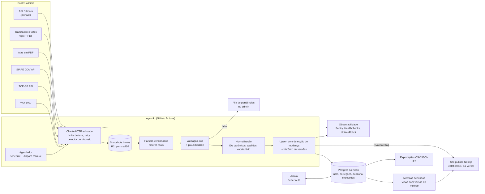

# Acompanhe seu Vereador — Relatório da Fase 1

**Pesquisa, diagnóstico e plano para discussão.** Nenhuma linha de código de aplicação foi escrita.
Data: 24/10/2026. Projeto do Observatório Social do Brasil – Pindamonhangaba.

Documentos de apoio (mesma pasta): `power-bi.md`, `camara-site.md`, `benchmark-design.md`, `stack-free-tiers.md`. Ambiente: `../environment.md`.

> Legenda de confiança usada no texto: **[verificado]** testado nesta pesquisa · **[fonte]** lido em documentação oficial · **[hipótese]** precisa ser confirmado (lista na seção 18.1).

---

## 1. Sumário executivo

**O que descobri**

1. **A Câmara tem uma API oficial de Dados Abertos** (sistema SoftCam), gratuita, que exige apenas um token obtido com cadastro de cidadão. Ela cobre vereadores em exercício, proposições por tipo e **por bairro**, legislação, pautas e publicações. É a base mais confiável para a automação. [verificado: documentação e comportamento sem token]
2. **Votações nominais existem e são públicas**: cada matéria tem uma linha do tempo (protocolo → pauta → votação → resultado) com quórum, resultado e o nome de cada vereador que votou, além de PDF oficial da votação. Isso não existe no Power BI e é o dado mais valioso do projeto. [verificado]
3. **Mas o site tem proteção anti-robô** (LiteSpeed reCAPTCHA). A partir do GitHub Actions, com identificação honesta, **a API passa; as páginas HTML, a tramitação e os PDFs recebem o desafio**. A política deste projeto é não contornar proteção. Logo, **a coleta de tramitação e votos depende de um pedido formal à Câmara** (liberar o coletor ou ampliar a API). Esse é o maior risco e a primeira decisão que precisa de você. [verificado]
4. **O Power BI atual é só contagem agregada** (vereador × ano × tipo), digitada a partir do site, sem registros individuais, sem fonte e sem atualização automática (última em 24/08/2026). Extraí o modelo completo e os dados como baseline para reconciliação. [verificado]
5. **Despesas da Câmara são coletáveis por duas fontes independentes**: o Portal da Transparência municipal (SIAPE GOV, API JSON pública, com a Câmara como entidade própria: empenhos, pagamentos, **diárias**, contratos, RH, emendas impositivas) e a API do TCE-SP (mensal, defasagem de ~2 meses). As duas passam no GitHub Actions. [verificado]
6. **O volume é pequeno**: ~8–10 mil proposições por ano, 11 vereadores, ~45 sessões ordinárias por ano (a 38ª de 2026 é em 27/10). Cabe com folga num Postgres gratuito. [verificado pela numeração das matérias]

**O que recomendo**

- **Produto:** site editorial, rápido e indexável, com 4 áreas (Vereadores, Proposições, Sessões, A Câmara) e busca. Todo número abre a lista que o compõe; todo registro mostra fonte e data de coleta; nada de ranking.
- **Dados:** API oficial primeiro; HTML só onde a API não cobre e só com anuência da Câmara; PDF apenas para atas (presença). Snapshots brutos guardados, parsers testados com fixtures reais, validação de plausibilidade que distingue "nada novo" de "coletor quebrado".
- **Stack:** Next.js 16.4 + TypeScript strict na Vercel; Postgres no Neon (São Paulo) com Drizzle e Zod; coletores em TypeScript como CLI rodando no GitHub Actions; snapshots no Cloudflare R2; Better Auth no admin; Sentry + Healthchecks.io + UptimeRobot. Custo inicial **US$ 0–20/mês** + domínio R$ 40/ano.
- **Sequência:** começar pelo que já é acessível (API + transparência), lançar com proposições, normas, pautas e despesas, e acrescentar tramitação/votações/presenças quando a Câmara liberar o coletor.

**Autocrítica honesta:** mapeei a estrutura do site com cerca de 20 requisições manuais; **não validei o conteúdo real da API** (precisa do token) nem a cobertura histórica. As seções de modelo de dados e ingestão estão desenhadas sobre o que vi, com as incertezas marcadas.

---

## 2. Diagnóstico do sistema atual (Power BI)

Detalhes completos e tabela de dados em `power-bi.md`.

**O que funciona**
- A pergunta central certa: "o que este vereador fez neste ano?".
- Glossário em linguagem simples para os 7 tipos de proposição.
- Identificação humana do vereador (foto, partido, subsídio).

**O que é ruim**
- Números sem saída: "637 requerimentos" não leva a nenhum requerimento.
- Coleta manual, sem fonte, sem data de coleta, sem método; atualização a cada vários meses.
- Gráficos de barras ordenados por volume que funcionam como ranking implícito.
- 10 páginas quase idênticas (uma por tipo) em tela fixa 1280×720: ilegível no celular, ruim para leitor de tela, nada indexável, nada compartilhável.
- Ausências praticamente zeradas: sinal de dado incompleto, não de presença perfeita.

**O que precisa desaparecer**
- A contagem digitada à mão.
- A ordenação por volume e a estética de painel corporativo.
- Um arquivo novo por legislatura.

**O que merece ser preservado**
- Todos os indicadores atuais (7 tipos + presença), por vereador e por ano, agora com o detalhe.
- O glossário, revisado e com base no Regimento.
- O baseline 2025–2026, importado como **"dado histórico (Power BI, 24/08/2026)"**, até ser reconciliado com a fonte.

Hipótese importante para a reconciliação: a soma de projetos de lei por vereador (347 em 2025) parece contar **coautoria para cada coautor**. Se confirmado, a plataforma deve mostrar as duas leituras — "projetos dos quais foi autor ou coautor" e "projetos distintos" — explicando a diferença.

---

## 3. Inventário de dados

| Dado | Fonte | Disponibilidade | Confiabilidade | Forma de coleta | Frequência | Observações |
|---|---|---|---|---|---|---|
| Vereadores em exercício (nome parlamentar, partido, foto) | Câmara — API `vereadores`; página `/camara/membros/exercicio/0` | Alta | Alta | API (token) | Diária | API só traz quem está em exercício |
| Vereadores de legislaturas anteriores | Câmara — seletor de autoria (~200 nomes com ID interno); TSE | Média | Média | HTML + TSE + revisão manual | Uma vez + por evento | Há duplicatas (mesma pessoa, IDs diferentes) |
| Nome civil, nome de urna | TSE (candidaturas); protocolo das matérias | Alta | Alta | CSV TSE | Por eleição | Apelidos variam ("Norbertinho" / "Norberto Moraes") |
| Partido atual e histórico | Câmara (atual); TSE (na eleição) | Alta / Média | Alta / Média | API + TSE | Diária / por eleição | Troca de partido no meio do mandato não vem estruturada [hipótese] |
| Votos na eleição, nº de mandatos | TSE dados abertos | Alta | Alta | CSV | Por eleição | O Power BI tinha isso sem fonte |
| Subsídio | Lei/resolução que fixa subsídio; SIAPE (estrutura remuneratória) | Alta | Alta | API legislação + SIAPE | Anual | Hoje é valor digitado |
| Legislaturas, mandatos, suplências, licenças | Atos da Mesa, pautas, notícias | Média | Média | HTML/PDF + revisão no admin | Por evento | Pouco estruturado; evento raro, revisão manual é aceitável |
| Mesa Diretora | Atos, notícias | Média | Alta | HTML + admin | Bienal | — |
| Comissões permanentes (7) e composição | `/pautas/comissao`, Atos (ex.: Ato 01/2025) | Média | Alta | HTML + admin | Anual | Pautas de comissão são coletáveis |
| Proposições (requerimentos, indicações, moções, emendas, vetos, PL, PLC, PDL, PR, atos…) | Câmara — API `proposicoes` por tipo | Alta | Alta | API (token), paginada | 2–3 h em dias úteis + reconciliação semanal | ~8–10 mil/ano |
| Ementa e texto integral | API [hipótese] + página HTML + PDF assinado | Alta | Alta | API / HTML / PDF | Junto com a proposição | Texto de honrarias traz dados pessoais de terceiros (LGPD) |
| Autoria e coautoria | Página da matéria; assinatura | Alta | Média | API/HTML | Junto | Forma de registrar coautoria a confirmar [hipótese] |
| **Proposições por bairro** | API `bairros` + `proposicoes&bairro=` | Alta | Alta (classificação da própria Câmara) | API | Diária | Atende "bairro Araretama" sem IA |
| Tramitação (linha do tempo) | `/ajax/tramitacao/{tipo}/{id}` | Alta | Alta | HTML (fragmento) | Para matérias alteradas | **Recebe desafio anti-robô no GitHub Actions** |
| **Votações nominais** (turno, quórum, resultado, voto de cada vereador) | Fragmento de tramitação + PDF `votacao_print_pdf` | Alta | Alta | HTML + PDF para conferência | Após cada sessão | **Mesmo bloqueio**; o presidente não aparece entre os votantes |
| Pautas das sessões | API `pautas`; `/pautas/...`; PDF | Alta | Alta | API | Diária | Inclui solenes, especiais, audiências |
| Sessões (calendário, tipo, número) | `/calendario`, pautas | Alta | Alta | API/HTML | Diária | Ordinárias às terças, 17h |
| Presença por sessão | Atas em PDF (chamada nominal) | Média | Média | Extração de PDF + validação | Semanal | Ausência justificada: fonte a confirmar [hipótese] |
| Normas resultantes (leis, resoluções, decretos legislativos) | API `legislacoes` | Alta | Alta | API (token) | Diária | Liga projeto → norma |
| Sanção, veto, promulgação | Tramitação + tipo "Vetos" + Jornal Oficial do município | Média | Alta | HTML/API | Por evento | Diário oficial: verificar Querido Diário [hipótese] |
| Despesas da Câmara (empenho, liquidação, pagamento, fornecedor) | SIAPE GOV (entidade 2); TCE-SP | Alta | Alta | APIs JSON | Diária (SIAPE) / mensal (TCE) | Duas fontes permitem reconciliação |
| **Diárias e passagens** | SIAPE `/execucao/diarias` | Alta | Alta | API | Diária | Atribuível a vereador quando ele é o beneficiário |
| **Emendas impositivas** (por vereador) | SIAPE `/emendas_parlamentares/*`; app DSI | Alta | Alta | API | Mensal | Muito relevante e ausente do Power BI |
| Contratos, licitações, atas de registro de preço | SIAPE + `/imprensa/transparencia/*` da Câmara | Alta | Alta | API/HTML | Semanal | Nível Câmara, não vereador |
| Servidores, cargos, lotação (inclui assessores) | SIAPE RH | Alta | Alta | API | Mensal | Sensível; ver decisão LGPD (seção 20) |
| Repasse de duodécimos | SIAPE receitas | Alta | Alta | API | Mensal | Contexto do orçamento da Câmara |
| Notícias oficiais | RSS `/jsonweb/web-rss.php` | Alta | Alta (versão oficial) | RSS | 2–3 h | Contexto, não fato primário |
| Vídeos das sessões | Canal da TV Câmara no YouTube | Alta | Alta | Link manual/feed | Semanal | Prova visual da sessão |
| Histórico 2021–2024 | Power BI antigo (xlsx no Drive); SoftCam (há matérias desde 2009) | Média | Média | Importação + reconciliação | Uma vez | Profundidade histórica do SoftCam a confirmar [hipótese] |
| Baseline 2025–ago/2026 | Power BI público (extraído) | Alta | Baixa (manual) | Importado | Uma vez | Marcado como histórico até reconciliar |

Não encontrei: despesas de gabinete por vereador (cota/verba indenizatória), registro de interesses, agenda individual. Se não existirem como dado público, a plataforma diz que não existem — não estima.

---

## 4. Dados adicionais possíveis (além do Power BI)

| Novo | Por que importa |
|---|---|
| Cada proposição individual, com ementa, texto, PDF oficial e link | Acaba com o "número mágico" |
| Linha do tempo da tramitação | Mostra o que aconteceu com o pedido, não só que ele existiu |
| Resultado (aprovado, rejeitado, arquivado, em tramitação) | Distingue apresentar de aprovar |
| **Votações nominais e voto de cada vereador** | O dado de maior valor cívico; viabiliza "votações divididas" |
| Normas resultantes | Liga projeto → lei |
| Proposições por bairro | Responde "o que pediram para o meu bairro?" |
| Sessões, pautas e presença por sessão | Presença com denominador real |
| Mesa Diretora, comissões, papéis institucionais | Contexto obrigatório (presidente não vota, relator, licença) |
| Emendas impositivas por vereador | Para onde cada vereador indicou recursos do orçamento |
| Diárias de vereadores | Gasto atribuível individualmente, com fonte |
| Despesas da Câmara como instituição | Contexto de custo do Legislativo |
| Natureza da proposição (rotineira/honorífica × substantiva) | Evita ler volume como mérito |
| Temas | Navegação por assunto ("saúde", "transporte") |
| Histórico de legislaturas | Comparar com o próprio passado, sem ranking |
| Exportações abertas (CSV/JSON) | Reuso por jornalistas, pesquisadores e outros observatórios |

---

## 5. Estratégia de ingestão — fonte por fonte

### 5.1 Câmara — API SoftCam (fonte principal)
- **Acesso:** token de cidadão (cadastro em `/cidadao`), guardado como secret. Requisição GET simples.
- **Coleta:** listas paginadas por tipo (`proposicoes&tipo=…&pagina=N`), por bairro, `legislacoes`, `pautas`, `vereadores`, `bairros`, `publicacoes`.
- **Incremental:** percorrer páginas mais recentes até encontrar itens já conhecidos e inalterados (hash do registro); reconciliação completa semanal.
- **Armadilhas conhecidas:** sem token, a API devolve **200 vazio** — tratar como erro de autenticação. Validar com Zod; campo inesperado vira alerta, não crash silencioso.
- **Primeira tarefa da implementação:** com o token, catalogar os campos reais de cada serviço (hipóteses H1–H4).

### 5.2 Câmara — tramitação e votações (HTML)
- **Endpoint:** `/ajax/tramitacao/{tipo}/{id}` (fragmento pequeno, ~4 KB) e PDF `/softcam/votacao_print_pdf.php?topico={id}`.
- **Gatilho:** só para matérias novas/alteradas e matérias pautadas na última sessão — dezenas por semana, não milhares.
- **Bloqueio:** desafio anti-robô a partir do GitHub Actions. **Sem contorno.** Caminhos legítimos, em ordem:
  1. Pedido formal do OSB à Câmara para incluir o User-Agent do coletor na lista de permissão do LiteSpeed (configuração simples para a TI deles) e, idealmente, expor tramitação/votações na API.
  2. Pedido via Lei de Acesso à Informação para carga histórica.
  3. **Coleta assistida** enquanto isso: um voluntário baixa no navegador o PDF de votação da sessão e envia pelo admin; o parser extrai, guarda hash e URL de origem. Reduz o trabalho manual de "contar" para "enviar um arquivo por semana".
- **Detector:** se a resposta for a página "Bot Verification", a execução para, marca a fonte como "bloqueada" e alerta.

### 5.3 Câmara — atas (presença)
- PDFs assinados `/assinatura/assinado/...`. Extração de texto com `unpdf`; parser específico para a chamada nominal; validação manual das primeiras dezenas de atas no admin até a taxa de acerto ser medida.
- Mesmo bloqueio de acesso que 5.2.

### 5.4 Portal da Transparência (SIAPE GOV)
- API JSON pública (`/portal-transparencia/api/...`), com a Câmara como `id_entidade=2`. Endpoints mapeados: empenhos, liquidações, pagamentos, diárias, adiantamentos, suprimento de fundos, duodécimos, contratos, atas, licitações, RH e emendas parlamentares.
- Parâmetros exatos a capturar com o navegador (Playwright) na implementação — a primeira tentativa direta devolveu erro 500, provavelmente por parâmetro faltando.
- Diária para despesas; mensal para RH e emendas.

### 5.5 TCE-SP
- `GET /api/json/despesas/pindamonhangaba/{ano}/{mes}` sem autenticação; filtrar `orgao = CÂMARA MUNICIPAL DE PINDAMONHANGABA`. ~260 eventos/mês.
- Uso: reconciliação independente das despesas do SIAPE e fonte de fallback. Defasagem de ~2 meses (agosto/2026 disponível em outubro).

### 5.6 TSE
- Dados abertos de candidaturas e resultados (2016, 2020, 2024): nome civil, nome de urna, partido, votos, situação (eleito/suplente).
- Coleta pontual por eleição, com revisão humana do casamento TSE ↔ Câmara.
- Minimização: não importar bens declarados, CPF, endereço, ocupação.

### 5.7 Fontes históricas
- Power BI 2025–2026: importado como "histórico não reconciliado".
- Planilhas 2021–2024 (Drive): idem, para a legislatura anterior.
- SoftCam: há matérias de 2009 e 2013 publicadas; a profundidade real se confirma com a API.
- SAPL/Plone antigos: fora do ar; não depender.

### 5.8 O que não fazer
- Playwright para coletar o site da Câmara (só seria necessário para passar pela proteção — o que não faremos).
- IA para extrair dados que a fonte já estrutura (bairro, tipo, autor).
- Raspar notícias como fonte de fato.

---

## 6. Arquitetura proposta

### 6.1 Diagrama



### 6.2 Componentes

| Componente | Responsabilidade | Decisão |
|---|---|---|
| Cliente HTTP | User-Agent honesto com contato, ≥ 1 s entre requisições por host, timeout, retry com backoff e jitter (só em erro de rede/5xx), detector de "Bot Verification" e de "200 vazio", lista de hosts permitidos (anti-SSRF) | Um único módulo; todos os coletores usam |
| Snapshots | Guarda o bruto antes de qualquer parse; chave por sha256 do conteúdo; metadados no banco (URL, data, status, hash, tamanho, run) | Permite reprocessar quando o parser melhora, sem rebaixar a fonte |
| Parsers | Funções puras: bruto → objetos tipados. Versionados (`parser_version` no registro) | Testados com fixtures reais (golden files) |
| Validação | Zod no formato; regras de plausibilidade no conjunto (volume vs. histórico, campos obrigatórios, datas no futuro, número/ano coerentes) | Falha de plausibilidade marca a execução como **suspeita**: não publica remoções, alerta |
| Normalização | Identidade canônica de vereador (apelidos), vocabulário controlado de tipos/situações/eventos, slugs | Tabelas de referência editáveis no admin |
| Upsert | Compara hash do registro normalizado; grava nova versão só se mudou; nunca apaga por ausência (marca "não visto na fonte desde…" após N confirmações) | Histórico de alterações auditável |
| Métricas | Views SQL com nome e versão do método (`metodo_v1`) | Todo número publicado sabe de qual consulta veio |
| Site | Next.js com páginas estáticas/ISR; `cacheTag` por entidade; a ingestão chama um endpoint assinado que invalida só o que mudou | Zero JS no cliente onde não precisa |
| Admin | Mesmo app, rota protegida, autorização verificada em cada Server Function | Sem SaaS de admin |
| Exportações | Geradas pela ingestão, publicadas no R2 (egress grátis) | O banco não serve download em massa |

### 6.3 Melhorias sobre o fluxo sugerido no briefing
- **Descoberta separada de detalhe:** primeiro "o que mudou?" (listas, feeds, pautas), depois "baixe os detalhes só disso". É o que torna a ingestão incremental e barata.
- **Reprocessamento sem rede:** parser novo roda sobre snapshots antigos.
- **Fila de pendências em vez de dead-letter queue:** registro que falha na validação vai para uma tabela visível no admin com o motivo. Sem infraestrutura de fila.
- **Disjuntor por plausibilidade:** "ontem 4.300, hoje 17" para a publicação e alerta, em vez de apagar 4.283 registros.
- **Sem remoção por ausência** sem confirmação.

---

## 7. Banco e modelo de dados

Postgres, modelo relacional próximo do padrão **Open Civic Data/Popolo** (pessoa, órgão, filiação, proposição, ação, evento de votação), o que facilita reuso pela rede OSB.

### 7.1 Entidades principais

| Grupo | Entidade | Notas |
|---|---|---|
| Pessoas | `pessoa` | nome civil; minimizado (sem CPF, sem endereço) |
| | `pessoa_apelido` | nomes parlamentares e variantes por fonte e período ("Norbertinho", "Norberto Moraes") |
| | `partido`, `filiacao` | filiação com início/fim e fonte |
| Mandatos | `legislatura` | número, início, fim |
| | `mandato` | pessoa × legislatura; titular/suplente; início/fim; votos (TSE) |
| | `afastamento` | licença, suplente que assumiu |
| Órgãos | `orgao` | Plenário, Mesa Diretora, 7 comissões |
| | `cargo_orgao` | pessoa × órgão × papel (presidente, relator…) × período |
| Proposições | `tipo_proposicao` | vocabulário controlado + **natureza** (normativa, fiscalizatória, honorífica, administrativa) + texto do glossário |
| | `proposicao` | ID da fonte (SoftCam), tipo, número, ano, ementa, data, regime, situação atual (derivada) |
| | `autoria` | proposição × (pessoa \| órgão \| Executivo \| iniciativa popular) × papel (autor, coautor) |
| | `relacionamento` | proposição ↔ proposição (emenda de, veto a, substitutivo de…) |
| | `evento_tramitacao` | data/hora, tipo (vocabulário), descrição original, sessão, documento |
| | `norma` | lei/resolução/decreto resultante e ligação com a proposição de origem |
| | `bairro`, `proposicao_bairro` | classificação da própria Câmara |
| | `tema`, `proposicao_tema` | origem (regra, IA, humano), revisado por, data |
| Plenário | `sessao` | tipo, número, data/hora, legislatura |
| | `presenca` | sessão × pessoa × status (presente, ausente, justificada, licença) |
| | `votacao` | sessão × proposição × turno × quórum × resultado × modo (nominal \| simbólica) |
| | `voto` | votação × pessoa × valor (sim, não, abstenção, não votou, ausente, **não vota por regra** — presidente) |
| Finanças | `despesa` | fonte (SIAPE/TCE), empenho, evento, fornecedor (PJ por CNPJ; PF mascarado), valor, data |
| | `diaria`, `emenda_impositiva` | com beneficiário/autor quando atribuível |
| Documentos | `documento` | URL oficial, tipo, hash, snapshot, assinado digitalmente |
| Proveniência | `fonte`, `execucao_coleta`, `snapshot` | fonte → execução → bruto |
| | `origem_registro` | linhagem por registro: entidade, id, snapshot, URL, extraído em, versão do parser |
| | `versao_registro` | histórico de mudanças (antes/depois) |
| Correções | `correcao_manual` | entidade, campo, valor corrigido, motivo, autor, **valor da fonte no momento da correção**, status |
| | `auditoria` | append-only: ator, ação, alvo, diff, quando |
| | `pendencia` | registros reprovados na validação, possíveis duplicatas, conflitos |
| Métricas | `metodo` | nome, versão, SQL/descrição, vigência — referenciado por toda métrica publicada |

JSON só onde faz sentido: payload bruto normalizado no snapshot e `diff` da auditoria. Nada de "registro inteiro em JSON" como substituto de coluna.

### 7.2 Política de correções manuais (source × normalizado × override × derivado)
- **Valor da fonte** e **valor normalizado** ficam nas tabelas de fatos e são sempre reescritos pela ingestão.
- **Correção manual** fica em `correcao_manual` e é aplicada **por cima**, numa view de leitura. A ingestão nunca a apaga.
- Ao corrigir, guarda-se o valor da fonte daquele momento. Se a fonte mudar depois, a correção vira **"em conflito"** na fila do admin: talvez a Câmara tenha corrigido o erro e o override possa sair.
- **Valor derivado** (contagens, percentuais) nunca é corrigido à mão: corrige-se o dado de base ou o método.
- Toda correção exige motivo, aparece no histórico público de correções (sem expor quem fez, se você preferir) e gera auditoria.

### 7.3 Identidade e URLs
- Chave interna: UUID. Chave da fonte: ID SoftCam, preservado.
- URL pública: `/proposicoes/{tipo}/{ano}/{numero}` (como o cidadão vê no documento) e `/vereadores/{nome-parlamentar}`; slugs nunca reaproveitados, 301 quando mudarem.

---

## 8. Stack

Pesquisa completa, versões e fontes em `stack-free-tiers.md`.

### 8.1 Recomendada
| Camada | Escolha | Por quê |
|---|---|---|
| Web + admin | **Next.js 16.4**, App Router, Cache Components, `ensureStatic` nas rotas públicas | Páginas estáticas com invalidação por entidade quando a ingestão roda; SEO; admin no mesmo app |
| Linguagem | TypeScript strict | Um ecossistema só para coletor, banco e site |
| Validação | **Zod 4** | Fronteiras (parsers, formulários, exportações) |
| Banco | **Postgres no Neon**, região São Paulo | Melhor free tier para o volume, branch por PR, extensões `unaccent`/`pg_trgm` |
| ORM | **Drizzle 0.45** (versão fixada) | SQL-first, migrations SQL legíveis e revisáveis |
| Busca | Postgres FTS (`portuguese` + `unaccent`) + `pg_trgm` | Suficiente para dezenas de milhares de registros |
| Coletores | CLI TypeScript (`fetch`/undici, cheerio, unpdf) | Portáveis: rodam no Actions, num VPS ou em função |
| Agendamento | **GitHub Actions** (repo público, grátis) com `schedule` + `workflow_dispatch` | Simples; heartbeat no Healthchecks avisa se parar |
| Snapshots e exportações | **Cloudflare R2** | 10 GB grátis, egress grátis, API S3 |
| Auth do admin | **Better Auth** (convite, TOTP ou passkey) | Dados no próprio banco; Auth.js entrou em manutenção |
| Observabilidade | Sentry + Healthchecks.io + UptimeRobot + tabela de execuções | Gratuito e suficiente |
| Testes | Vitest, Testcontainers (Postgres real), Playwright + axe-core | — |

**Ajuste que faço sobre a pesquisa de stack:** ela sugere um Worker do Cloudflare como relógio externo para evitar atrasos e a desativação do `schedule` após 60 dias sem atividade. Concordo com o risco, discordo da prioridade: **começar só com `schedule`** + alerta de heartbeat (se o workflow for desativado, o alerta chega e reativar é um clique). O relógio externo entra se o atraso medido incomodar. Complexidade precisa pagar aluguel.

### 8.2 Alternativa conservadora
Next.js na **Vercel Pro** + **Supabase Pro** (Postgres com backup diário, Storage, sem pausa) + coletores como funções agendadas no Vercel Cron. ~US$ 45/mês. Menos peças, mais garantias, mais custo e um pouco mais de amarração ao Supabase.

### 8.3 Alternativa independente de vendor
Um VPS em São Paulo (ou Oracle Always Free) com Docker Compose: Next.js `standalone`, Postgres 18, Caddy; coletores via systemd timer; backups para B2/R2; Cloudflare na frente. ~€6–20/mês. **Vantagem extra neste caso: IP fixo brasileiro, fácil de a Câmara liberar.** Desvantagem: manutenção alta (patches, backups, restores) para um projeto de voluntários.

### 8.4 Comparação
| Critério | Recomendada | Conservadora | Independente |
|---|---|---|---|
| Custo inicial | US$ 0 (Hobby) ou 20 (Pro) | ~US$ 45 | ~€6–20 |
| Custo com crescimento | ~US$ 25–40 | ~US$ 45–70 | ~€10–20 |
| Manutenção | Baixa | Muito baixa | Alta |
| Lock-in | Médio-baixo | Médio | Baixo |
| IP fixo para liberação na Câmara | Não (Actions) | Não | **Sim** |
| Previews por PR | Sim | Sim | Não (montar) |

---

## 9. Estratégia free tier

| Componente | Serviço / plano | Limite relevante | Uso estimado | Plano B |
|---|---|---|---|---|
| Site + admin | Vercel Hobby | 100 GB de banda, 1 M requisições CDN, 4 h CPU ativa; **uso não comercial pessoal**; sem repo de organização; 1 seat | Site quase todo estático: folgado | Vercel Pro US$ 20 |
| Banco | Neon Free | 1 GB, 100 CU-h, 5 GB egress; estourar = banco suspenso até o mês seguinte; histórico de 6 h | < 300 MB/ano; ~25 CU-h com autoscaling limitado | Neon Launch (sem mínimo) |
| Coleta | GitHub Actions (repo público) | grátis; `schedule` mínimo 5 min, atrasos; desativa após 60 dias sem atividade | ~10–30 min/dia | Relógio externo (Cloudflare Worker) ou VPS |
| Snapshots/exportações | Cloudflare R2 | 10 GB, egress grátis; **exige cartão** | < 1 GB/ano | Backblaze B2 |
| Backups | `pg_dump` noturno → R2 | — | MBs | — |
| Erros | Sentry Developer | 1 usuário, 5 mil erros, 1 cron monitor | baixo | Patrocínio open source do Sentry |
| Heartbeat | Healthchecks.io | 20 checks | ~8 | plano grátis para nonprofit/open source |
| Uptime + status | UptimeRobot | 50 monitores, 5 min | ~5 | Better Stack |
| Domínio | Registro.br | R$ 40/ano | 1–2 domínios | — |

**Armadilhas que já evitei no desenho:** cron horário na Vercel Hobby (não existe), snapshots no Vercel Blob (estoura 2 mil uploads/mês), Supabase Free (pausa e não faz backup), Prisma Postgres (cobra por operação), Railway (incidente de segurança em 21/10/2026).

---

## 10. Produto

### 10.1 Arquitetura de informação
Menu principal: **Vereadores · Proposições · Sessões · A Câmara** + **Buscar**. Utilitário: **Sobre os dados**. Rodapé: Metodologia · Dados abertos · Correções · Sobre · Contato · Reportar erro · "Mantido pelo OSB Pindamonhangaba. Este não é o site oficial da Câmara."

Itens do briefing que **não** viram menu, e por quê:
- **Votações:** dentro de Sessões (com URL própria `/votacoes`); vira menu se houver volume.
- **Temas:** filtro e páginas `/temas/{slug}` quando a classificação for validada.
- **Comparar:** visão "lado a lado" dentro de Vereadores, em ordem alfabética, mesmo período, com denominadores — nunca ranking.
- **Explorar dados:** as listas filtráveis são o explorador; downloads em `/dados`. Recriar um BI seria recriar o problema.

### 10.2 Mapa do site
```
/                                  Início
/vereadores                        11 atuais; anteriores por filtro de legislatura
/vereadores/{slug}                 Perfil (abas: proposições · votos · presenças · despesas · sobre os dados)
/vereadores/lado-a-lado            Tabela neutra
/proposicoes                       Lista + busca + filtros (tipo, autoria, situação, período, bairro, tema, natureza)
/proposicoes/{tipo}/{ano}/{numero} Proposição
/sessoes                           Calendário e lista
/sessoes/{aaaa-mm-dd}-{tipo}       Sessão: pauta, presenças, votações, vídeo
/votacoes                          Votações nominais (?divididas=1)
/camara                            Como funciona, Mesa, comissões, composição
/glossario/{termo}                 Um termo por URL
/dados                             Downloads, dicionário, calendário de coleta, status das fontes
/metodologia/{topico}              Presença, votações, natureza, temas, limites
/correcoes                         Histórico público de correções
/sobre                             OSB, princípios editoriais, contato
```

### 10.3 Páginas-chave
- **Início:** o que aconteceu na última sessão e o que vem na próxima; os 11 vereadores (ordem alfabética); "desde a última sessão: N proposições novas, M substantivas"; votações divididas recentes; busca; explicador "como funciona a Câmara em 2 minutos"; selo "dados até dd/mm hh:mm".
- **Vereador:** foto com crédito, nome parlamentar e civil, partido (com histórico), mandatos, cargos, contato oficial; "Em resumo" com 3–4 frases factuais geradas por modelo de texto (ex.: "Entre 01/01/2025 e 23/10/2026, foi autora ou coautora de **241 requerimentos**…", cada número é link); atividade recente; abas.
- **Proposição:** status em uma linha com data; etapas por tipo (Protocolado → Lido → Comissões → Pauta → Votado → Sancionado/Vetado); ementa; nota de contexto do tipo ("Indicação é uma sugestão ao Executivo e não obriga a Prefeitura"); autores; linha do tempo (principais eventos visíveis, demais sob demanda); votações; norma resultante; documentos e link oficial; rodapé de fonte.
- **Sessão / votação:** resultado em texto ("Aprovado · 7 sim, 3 não, 1 ausente"), 11 marcadores com nome agrupados por voto, quórum com link ao glossário; votação simbólica escrita como tal.

### 10.4 Fluxos principais
1. "O que meu vereador fez?" → Vereadores → perfil → clique no número → lista filtrada → proposição → documento oficial.
2. "O que pediram para o meu bairro?" → Buscar "Araretama" → filtro de bairro aplicado (classificação da própria Câmara) → lista → compartilhar URL no WhatsApp.
3. "Como votaram no projeto X?" → busca "PL 45/2026" → proposição → votação → voto de cada um.
4. "De onde vem esse número?" → "Sobre estes dados" → método versionado → consulta → download.

### 10.5 Busca
Uma caixa que entende "PL 45/2026", "req 2398/2026", nome de vereador (com tolerância a erro via `pg_trgm`) e texto livre (FTS em português sem acento, pesos: ementa > texto). Filtros na URL. Resultados agrupados por tipo de entidade.

### 10.6 Uso de IA — avaliado caso a caso
| Uso | Precisa? | Decisão proposta |
|---|---|---|
| Extrair bairro | Não | A própria Câmara classifica por bairro na API |
| Classificar tipo, autor, situação | Não | Vêm estruturados da fonte |
| Natureza (rotineira × substantiva) | Pouco | Regras por tipo + palavras-chave da ementa, revisáveis no admin |
| Tema | Talvez | Regras primeiro; IA (modelo pequeno, em lote, resultado persistido) só para sugerir, com rótulo "classificação automática" e revisão humana para os temas publicados |
| Resumo cidadão | Sim, mas restrito | Só para projetos de lei e de resolução (centenas/ano), gerado uma vez por versão do texto, rotulado, ao lado do original; nunca para requerimentos/indicações (a ementa já é o resumo) |
| Explicar situação de tramitação | Não | Texto fixo por tipo de evento no vocabulário controlado |

Custo estimado com modelo pequeno em lote: centavos a poucos dólares por ano. Nenhuma chamada de IA quando o cidadão abre a página.

---

## 11. UI/UX

Referências e princípios completos em `benchmark-design.md` (12 princípios).

### 11.1 Direção visual: editorial cívico
- Inspiração de produto: OpenParliament.ca (URLs e notas de contexto), HowTheyVote.eu (página de votação e bloco de fonte), TheyWorkForYou (método público de votos), GOV.UK/USWDS (componentes: summary list, inset text, details, tag, collection, step indicator), Our World in Data (ficha técnica de cada gráfico).
- Tom: jornal sério e acolhedor — papel claro, tinta escura, tipografia bem feita, poucos elementos, muito respiro. Nenhum card decorativo, gradiente, sombra grande, ícone aleatório ou animação gratuita.
- Behance e Awwwards não trouxeram referência útil para dados legislativos (análise na pesquisa).

### 11.2 Identidade a partir da marca do OSB
- Marca do OSB: mapa do Brasil em verde-folha, raios amarelos, lupa, e o logotipo "Observatório" em **serifa de alto contraste**. O Power BI já usava `#1C6437`, `#8ABF42` e `#9ABD4F`.
- Tradução para o produto: serifa editorial nos títulos (eco do logotipo) + sans humanista na interface.
- **Tipografia:** Source Serif 4 (títulos, textos) + Source Sans 3 (interface, tabelas). Ambas com algarismos tabulares e bons acentos. Auto-hospedadas, subset latin + latin-ext.

### 11.3 Tokens semânticos (proposta, com contraste medido)
| Token | Claro | Escuro | Regra |
|---|---|---|---|
| `background` | `#FAFAF7` (papel) | `#121512` | — |
| `surface` | `#FFFFFF` | `#1A1F1A` | — |
| `foreground` | `#1A1F1A` (16:1) | `#ECEFEA` | texto |
| `muted` | `#5B635B` (5,9:1) | `#A3AAA3` (7,7:1) | texto secundário |
| `primary` | `#1C6437` (6,9:1) | `#8ABF42` (8,4:1) | links, botões, foco |
| `brand-leaf` | `#8ABF42` (2,1:1) | — | **só decorativo** (marca, ilustração), nunca texto ou borda funcional |
| `accent` | `#8A6A00` (4,9:1) | `#E3D23B` (11,9:1) | destaques pontuais (raios do logo) |
| `border` | neutro de 3:1 contra o fundo | idem | componentes (WCAG 1.4.11) |
| `success` / `warning` / `danger` | só para estado do sistema (coleta ok, atrasada, falhou) | idem | **nunca** para julgar vereador |
| `data-series-*` | paleta categórica neutra validada por contraste e daltonismo | idem | sem cores de partido; sem verde=bom/vermelho=ruim |

Votos codificados por forma e cor ao mesmo tempo: ● sim · ✕ não · ◌ ausente · — não vota por regra.

### 11.4 Mobile, acessibilidade e performance
- Mobile de verdade: listas de registros como lista de cartões semânticos; tabelas reais só para comparação, com primeira coluna fixa e rolagem horizontal dentro de região rotulada; filtros em painel de tela cheia com contagem por opção e botão "Mostrar N resultados"; linha do tempo vertical.
- WCAG 2.2 AA desde o design system: contraste medido nos tokens, foco visível, alvos ≥ 24 px, toggletips (não tooltips de hover) para jargão, gráficos com "ver como tabela" e texto alternativo gerado do mesmo modelo de frase, `prefers-reduced-motion`, testes com axe no CI.
- Orçamentos: LCP < 2,0 s em 4G de celular médio; CLS < 0,05; INP < 200 ms; JS no cliente ≤ 70 KB gzip nas páginas públicas (a maioria com zero); HTML < 150 KB; imagens AVIF/WebP com `sizes`.

### 11.5 SEO e compartilhamento
URLs humanas, canonical, title/description por entidade, Open Graph com imagem gerada por vereador e proposição (estática), sitemap index por tipo, robots, JSON-LD (`Person` com `memberOf`, `Legislation`, `GovernmentOrganization`, `Dataset` para os downloads).

---

## 12. Admin

Pragmático, no mesmo app, com Better Auth (convite, sem cadastro aberto; TOTP ou passkey; papéis `admin` e `editor`).

| Tela | Conteúdo |
|---|---|
| Fontes | status por fonte (ok, atrasada, bloqueada, degradada), última coleta bem-sucedida, próxima prevista |
| Execuções | histórico: duração, itens vistos/novos/alterados, erros, avisos, snapshots; detalhe de falha |
| Pendências | registros reprovados na validação, possíveis duplicatas (ex.: mesmo vereador com dois IDs), conflitos de correção |
| Correções | criar/remover override com motivo; ver valor da fonte × corrigido |
| Identidades | casar apelidos e pessoas; vocabulário de tipos, situações, temas |
| Coleta assistida | enviar PDF de votação/ata; ver o que o parser extraiu antes de publicar |
| Ações | rodar coleta agora (dispara o workflow), reprocessar a partir de snapshots |
| Usuários e auditoria | quem fez o quê e quando (append-only) |

---

## 13. Automação

- **Agendas:** API da Câmara a cada 2–3 h em dias úteis, 1× nos fins de semana; tramitação/votos após cada sessão (terça à noite e quarta de manhã) quando liberado; SIAPE diário; TCE-SP mensal; TSE por eleição.
- **Concorrência:** um coletor por fonte de cada vez (`concurrency` no workflow); timeout por execução.
- **Retries:** backoff exponencial com jitter só para falha de rede e 5xx; 4xx e "Bot Verification" não são repetidos.
- **Checkpoints:** cursor por fonte (última página/ID visto) no banco; uma execução interrompida retoma.
- **Monitoramento:** cada execução grava `execucao_coleta`, faz ping no Healthchecks (início, sucesso, falha) e manda erros ao Sentry; UptimeRobot monitora o site e a página de status das fontes; alerta por e-mail.
- **Pós-coleta:** invalidação de cache só das entidades alteradas; regeneração das exportações.
- **Backups:** `pg_dump` noturno para o R2 com retenção (30 diários + 12 mensais) e teste de restauração mensal documentado.

---

## 14. Segurança e privacidade

**Segurança**
- Segredos só em variáveis de ambiente (Vercel, GitHub Actions); `.env.example` sem valores; validação de ambiente na inicialização (Zod).
- Papéis de banco separados: leitura para o site, escrita para a ingestão, migrations com outro usuário.
- Autorização checada no servidor em toda Server Function/rota do admin (nunca só no `proxy.ts`).
- Cabeçalhos: CSP estrita, HSTS, `X-Content-Type-Options`, `Referrer-Policy`, `Permissions-Policy`; CSRF coberto pelas Server Actions + cookies `SameSite`.
- Rate limiting no login e nos endpoints de exportação filtrada.
- Coletores só acessam hosts de uma lista permitida (anti-SSRF); limites de tamanho e timeout em PDFs.
- Dependências: Renovate/Dependabot com janela semanal (o Next.js teve patches de segurança frequentes em 2026), `pnpm audit` e CodeQL no CI, secret scanning do GitHub.
- Logs sem segredos e sem dados pessoais além do necessário.

**LGPD e responsabilidade editorial**
- Base: dados de agentes públicos no exercício da função são de interesse público; ainda assim, minimizar.
- Não coletar CPF, endereço, bens, dados de familiares.
- **Textos de honrarias** citam cidadãos comuns (biografia, data de nascimento): não republicar o texto integral dessas espécies; mostrar ementa e link oficial.
- Fornecedores pessoa física em despesas: mostrar nome só quando a fonte oficial já publica e houver função pública (ex.: diária de vereador); caso contrário, "pessoa física" com link à fonte.
- Distinguir sempre "dado oficial da Câmara" de "dado de outra fonte pública" e de "dado derivado pelo OSB".
- Páginas obrigatórias: política de privacidade (o site não coleta dados do visitante além de métricas agregadas sem cookies), termos de uso, canal de correção com prazo de resposta, e espaço para manifestação do vereador sobre os próprios dados.

---

## 15. Qualidade

| Camada | O que cobrir |
|---|---|
| Parsers | fixtures reais (HTML, JSON, PDF) → saída esperada; um caso por variação conhecida; teste que falha se o layout mudar |
| Plausibilidade | regras sobre o conjunto (volume vs. média móvel, campos obrigatórios, numeração sequencial, datas) |
| Banco | migrations aplicadas do zero num Postgres real (Testcontainers); FTS; triggers de auditoria; view de overrides |
| Unidade | normalização, apelidos, métodos de métricas |
| Contrato número = lista | para cada contagem publicada, teste que compara com o total da lista correspondente |
| E2E | login no admin, correção + auditoria, busca, filtro por URL, exportação |
| Acessibilidade | axe nas páginas principais no CI + revisão manual com leitor de tela antes do lançamento |
| Performance | Lighthouse com orçamentos nas previews |
| Smoke pós-deploy | páginas-chave respondem, últimas coletas recentes, sitemap válido |

Definition of done do briefing adotada como está.

---

## 16. DevOps

```
commit → CI (lint, typecheck, testes, build, migrations num Postgres efêmero)
       → preview na Vercel + branch do Neon por PR
       → revisão → merge na main
       → migrations aplicadas por job com aprovação (environment "production")
       → deploy de produção → smoke test
```

- Repositório: sugiro renomear para **`acompanhe-seu-vereador`** (o GitHub redireciona o nome antigo). Branch `main` protegida (PR obrigatório, CI verde), Conventional Commits, Renovate, CodeQL, templates de issue só para "erro nos dados" e "sugestão".
- Migrations: SQL gerado pelo Drizzle, revisado no PR, aplicado por job — nunca `db push` em produção; seed só com dados fictícios para desenvolvimento, separado de qualquer dado real.
- Vercel: projeto conectado ao GitHub, previews por PR, produção na `main`, variáveis por ambiente, previews protegidas (Vercel Authentication) enquanto houver admin com dados de teste.

---

## 17. Documentação

```
README.md                 o que é, como rodar, como contribuir
CLAUDE.md                 memória para sessões do Claude Code
HANDOFF.md                estado atual e próximos passos
docs/architecture.md      visão geral e diagramas
docs/data-sources.md      fontes, acesso, limites, contatos
docs/data-model.md        entidades, relações, política de correções
docs/ingestion.md         coletores, agendas, plausibilidade, reprocessamento
docs/deployment.md        ambientes, migrations, variáveis
docs/admin.md             manual do administrador
docs/methodology.md       base da página pública de metodologia
docs/troubleshooting.md   o que fazer quando uma fonte quebra
docs/security.md          ameaças, controles, LGPD
docs/adr/NNNN-*.md        decisões (a partir da aprovação deste plano)
docs/research/            esta pesquisa
```

---

## 18. Riscos

| Risco | Probabilidade | Impacto | Mitigação |
|---|---|---|---|
| **Câmara não libera o coletor** para tramitação/votos | Média | Alto | Pedido institucional cedo; LAI; coleta assistida por PDF; lançar com o que a API cobre |
| Anti-robô bloquear também a API | Baixa | Alto | Detector + alerta; token identifica o cliente; contato com a TI da Câmara |
| Troca do sistema da Câmara (PHP 7.4 em fim de vida; já trocaram SAPL/Plone → SoftCam) | Média em 2–4 anos | Alto | Snapshots brutos + parsers isolados por fonte + modelo próprio independente do fornecedor |
| Mudança de layout/HTML | Média | Médio | Fixtures, plausibilidade, alerta, reprocessamento |
| API mudar campos sem aviso | Média | Médio | Zod estrito com alerta em campo desconhecido |
| Erro silencioso (200 vazio, página de desafio) | Alta | Alto | Detectores explícitos + disjuntor |
| Inconsistência entre fontes (SIAPE × TCE; apelidos) | Alta | Médio | Reconciliação explícita; divergência vira pendência, não "correção automática" |
| Dados históricos incompletos | Alta | Médio | Rótulo "histórico importado"; lacuna mostrada como lacuna |
| Interpretação legislativa errada (ex.: presidente "ausente") | Média | Alto | Regras do Regimento revisadas por alguém do OSB; vocabulário controlado; notas de papel |
| Leitura de volume como mérito / uso político | Alta | Alto | Sem ranking, natureza da proposição, contexto obrigatório, princípios editoriais publicados |
| Termos da Vercel Hobby (uso institucional) | Média | Médio | Confirmar com o suporte ou usar Pro no lançamento |
| Neon estourar cota e suspender | Baixa | Alto | Autoscaling limitado, cache agressivo, exportações fora do banco, alerta de uso |
| `schedule` do Actions desativado por inatividade | Média | Médio | Heartbeat + alerta; relógio externo se necessário |
| Token/credencial expirar | Média | Médio | Datas anotadas, heartbeat detecta |
| Sustentabilidade (voluntários saem) | Alta | Alto | Custo ~zero, documentação, dados depositados, "modo arquivo" planejado |
| Nome "Acompanhe seu Vereador" já usado pelo OS Campos Gerais (hoje fora do ar) | Baixa | Baixo | Alinhar com o OSB nacional |
| Fotos oficiais e direitos de imagem | Baixa | Baixo | Usar as fotos oficiais com crédito; pedir autorização formal junto com o pedido do token |

### 18.1 Hipóteses a verificar (primeiras tarefas da implementação)
- **H1** — Campos reais de cada serviço da API (precisa do token).
- **H2** — A API traz situação/tramitação ou só dados básicos?
- **H3** — Profundidade histórica do SoftCam (desde quando há matérias e normas).
- **H4** — Como a coautoria é representada.
- **H5** — Toda votação registra votos individuais ou há votação simbólica sem registro?
- **H6** — Quando o presidente vota (Regimento Interno) — redação da nota de contexto.
- **H7** — Onde ficam ausências justificadas.
- **H8** — Parâmetros das consultas do SIAPE GOV (captura no navegador).
- **H9** — Cobertura do Jornal Oficial de Pindamonhangaba no Querido Diário.
- **H10** — Se o bloqueio anti-robô é por IP, por User-Agent ou por reputação (só a TI da Câmara pode responder; não vamos testar contornos).

---

## 19. Ambiente Claude Code preparado

| Ferramenta | Versão | Origem | Escopo | Função | Observações |
|---|---|---|---|---|---|
| Superpowers | 6.4.2 | obra (Jesse Vincent), diretório oficial Anthropic | Projeto | brainstorming, planos, execução, TDD, debugging sistemático, verificação antes de concluir, code review, subagentes | habilitado em `.claude/settings.json` |
| frontend-design | build 58267944 | Anthropic | Projeto | direção visual de UI | — |
| Playwright MCP | build 7d7dbbd9 | Microsoft | Projeto | navegador para QA e captura de requisições | Chromium já no contêiner |
| security-guidance | 2.0.13 | Anthropic | Conta | alertas de segurança ao editar | já ativo (disparou ao editar o workflow) |
| modern-web-guidance | 0.0.194 | Anthropic | Conta | boas práticas web | já ativo |
| design (accessibility-review, ux-copy) | — | Anthropic | Conta | acessibilidade e microcopy | já ativo |
| code-review, security-review, simplify | — | Claude Code | Nativo | revisão | — |
| MCPs GitHub, Vercel, Supabase, Google Drive, Context7, Brandfetch | — | conectores claude.ai | Conta | integração | Vercel Sandbox usado na pesquisa |
| Memória | — | repositório | Projeto | `CLAUDE.md`, `HANDOFF.md`, `docs/` | memória nativa não persiste em contêiner efêmero |
| Sondagem de fontes | — | repositório | Projeto | `.github/workflows/source-probe.yml` | roda manualmente ou quando o próprio arquivo muda |

Detalhes e o que deliberadamente não foi instalado: `docs/environment.md`.

Limites que respeitei: o classificador de segurança bloqueou o uso de proxy de terceiros, o teste de variação de User-Agent contra o anti-robô e a edição das minhas próprias permissões. Os três bloqueios estavam certos.

---

## 20. Decisões que preciso de você

1. **Pedido institucional à Câmara** (o mais importante). O OSB envia ofício pedindo: (a) liberação do User-Agent do coletor no anti-robô; (b) se possível, tramitação, votações e presenças na API; (c) autorização de uso das fotos oficiais. Quem assina e quando?
2. **Token da API:** alguém do OSB cria a conta de cidadão no site da Câmara e me passa o token como secret (nunca no chat ou em commit).
3. **Enquanto a Câmara não libera:** aceita a **coleta assistida** (voluntário envia o PDF de votação/ata pelo admin) como ponte? Ou prefere lançar sem votações e presenças?
4. **Hospedagem:** Vercel Hobby durante o desenvolvimento e Pro (US$ 20/mês) no lançamento? Ou confirmar com a Vercel que o uso por ONG voluntária cabe no Hobby? Ou a opção de VPS em São Paulo (IP fixo, mais manutenção)?
5. **Cartão para o Cloudflare R2** (uso esperado dentro do grátis). Se não houver, uso Backblaze B2.
6. **Domínio:** `acompanheseuvereador.org.br` exige CNPJ do OSB Pindamonhangaba (R$ 40/ano). Registrar agora ou no lançamento? Quer também o `.com.br` defensivo?
7. **Licenças:** código **MIT** (máximo reuso pela rede OSB) ou **AGPL-3.0** (obriga quem reusar a publicar melhorias)? Dados: **CC BY 4.0**?
8. **Profundidade histórica da v1:** só a legislatura atual (2025–2028) ou também 2021–2024?
9. **Dados pessoais:** mostrar nomes de assessores/servidores (o portal oficial já mostra)? Minha recomendação: não na v1; mostrar só agregados por gabinete se a fonte permitir atribuição.
10. **IA:** autoriza classificação temática assistida e resumo cidadão de projetos de lei, sempre rotulados e com revisão humana antes de publicar o tema? Quem revisa?
11. **Governança editorial:** quem são os administradores, quem aprova correções e qual o e-mail público de contato e correção?
12. **Nome e rede:** confirmar "Acompanhe seu Vereador" com o OSB nacional (o OS Campos Gerais usou o mesmo nome) e se o código deve nascer pensado para outros observatórios.
13. **GitHub:** posso criar a branch `main` com um commit inicial (README e licença) para abrir o PR desta pesquisa e depois renomear o repositório para `acompanhe-seu-vereador`?

---

## 21. Roadmap

Cada fase termina com algo funcionando e verificável. Fases 2–3 dependem só do token; a 7 depende da Câmara.

| # | Fase | Entrega verificável |
|---|---|---|
| 0 | Pré-requisitos (paralelo) | Ofício enviado; token obtido; decisões da seção 20 respondidas |
| 1 | **Foundation** | `main` protegida, README, licença, CI verde (lint, typecheck, testes, build); app Next.js vazio com headers de segurança em preview; Postgres + migrations reproduzíveis; ADRs 0001–0005 |
| 2 | **Ingestão — núcleo + API da Câmara** | Cliente HTTP educado, snapshots no R2, `execucao_coleta`, plausibilidade; coletor de vereadores/proposições/normas/pautas/bairros via API rodando no Actions; fixtures; relatório das hipóteses H1–H4 |
| 3 | **Modelo e reconciliação** | Modelo completo (pessoas, mandatos, apelidos, proposições, autoria, normas); importação do baseline do Power BI; relatório de divergências fonte × Power BI |
| 4 | **Admin mínimo** | Login com 2FA; telas de fontes, execuções, pendências, correções e auditoria |
| 5 | **Público — Vereadores e Proposições** | Perfis e páginas de proposição com proveniência; teste "número = lista" no CI; mobile e axe aprovados |
| 6 | **Busca** | FTS + trigramas + filtros na URL + bairro; tempos medidos |
| 7 | **Tramitação, sessões e votações** | Coletor da tramitação (se liberado) ou coleta assistida; páginas de sessão e votação; votações divididas |
| 8 | **Presenças** | Extração das atas com taxa de acerto medida; metodologia de presença publicada |
| 9 | **Transparência** | Despesas da Câmara (SIAPE × TCE reconciliados), diárias, emendas impositivas |
| 10 | **Metodologia e dados abertos** | Páginas de metodologia, glossário, correções; exportações CSV/JSON com dicionário |
| 11 | **Temas e IA (opcional)** | Classificação por regras + sugestão por IA rotulada e revisada |
| 12 | **Hardening** | Auditoria de acessibilidade manual, orçamentos de performance, revisão de segurança, alertas, teste de restauração de backup |
| 13 | **Lançamento** | Domínio, produção, status page, anúncio |

Próximo passo concreto após sua aprovação: Fase 1, começando por `superpowers:writing-plans` para transformar este roadmap em plano de implementação detalhado da Foundation.
